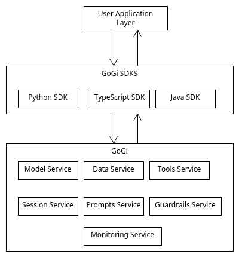

# gogi[AI]

gogi is a platform, written in Go, for building generative AI and agentic applications. It is the infrastructure
layer underneath an application that uses LLMs. Instead of talking to model providers, vector stores and secret
managers itself, the application calls the platform's services through an SDK. The platform takes care of what
every such application needs: running models reliably, keeping conversations, retrieving knowledge, calling tools
safely, enforcing policies, and seeing what every request did and cost.

## Services

| Service                                              | Responsibility                                                        |
|------------------------------------------------------|-----------------------------------------------------------------------|
| [Model service](docs/model_service.md)               | Runs models from any provider with one API; retries, fallbacks, registered self-hosted models |
| [Prompt service](docs/prompt_service.md)             | Versioned prompts and their metadata                                  |
| [Session service](docs/session_service.md)           | Conversations, memories, and context that fits a token budget         |
| Data services (indexes, documents)                   | Indexes, document ingestion and search                                |
| [Tool service](docs/tool_service.md)                 | A registry of tools, executed with injected credentials               |
| [Guardrails service](docs/guardrails_service.md)     | Input, output and action policies, with an audit trail                |
| [Observability service](docs/observability_service.md) | Traces, scores, logs, metrics, cost and budgets                     |
| Workflow service                                     | Workflows, their deployments, and long-running jobs                   |

Applications reach every service through a single gateway. The [overview](docs/gogi_overview.md) explains how the
pieces fit together and how a request flows through them.

## Features

What the platform does today, by area. The service pages linked above have the details.

**Models**
- One API for every model, whichever provider serves it: OpenAI and Anthropic built in, and self-hosted models
  (vLLM, TGI, Ollama or any OpenAI-compatible server) registered at run time, with their capabilities and health.
- Streaming responses, tool calling in the OpenAI format whatever the provider, and JSON answers that match a schema.
- Images with a message's text, given as bytes or as a document the platform holds, sent to each provider in its
  own format.
- Reliability: retries with backoff, detection of stalled calls, a circuit breaker per model, and fallback to other
  models, configured per request or by default.
- The cost and tokens of every call, priced from a price table that can be extended.

**Prompts**
- Versioned prompts with metadata, stored in the object store, used by name as a model's system prompt.

**Conversations and memory**
- Sessions and their messages, tool calls included, kept per user.
- Context that fits a token budget, with strategies that summarise or drop older messages but never break a tool
  call, and memories (facts about a user) brought into the context.
- Retrieval of what was said across a user's sessions.

**Knowledge: indexes and documents**
- Indexes shared with members who are owners or readers.
- Ingestion of text, Markdown and PDF documents in the background: uploads of up to 100 MB are streamed and kept in
  the object store, chunked, embedded and stored in the vector store, with the job's progress to follow.
- Files kept without being ingested, e.g. videos, and documents whose content is replaced after they are edited.
- Documents listed and searched by their metadata, read section by section (Markdown headings, a PDF's outline or
  pages), downloaded whole or as a byte range, and deleted with everything made from them.
- Ingestion runs in a worker of its own, a Lambda or Azure Function in the cloud, so it never holds up searches or
  deletes, and deleting a document stops its ingestion.

**Tools**
- A registry of tools with namespaces and versions, discovered by capability, and tools imported from MCP servers.
- Execution by the platform, with the tool's credential injected from the secrets manager, within rate and
  execution limits, and a circuit breaker for tools that keep failing.

**Guardrails**
- Policies on inputs, outputs, tool calls and behaviour, in enforce or shadow mode, with human approval gates and
  an audit trail of every decision.

**Observability**
- A trace per request across every service, with a span per call and a generation per model call.
- Scores (from code, a model judge, a human or user feedback), structured logs, metrics, cost reports grouped by
  model, user, workflow and more, and budgets with alerts.

**Workflows**
- Registration, deployment and rollback of an application's workflows, with routes to them, and tracking of
  long-running jobs: their progress, checkpoints, and completion or failure.

**Operations**
- One gateway for every service, routing calls and reporting the platform's health (gRPC health checks).
- Credentials kept in HashiCorp Vault or AWS Secrets Manager and referred to by name, never stored in registrations.
- Docker Compose and Kubernetes deployments.

## Getting started

- [Installation](docs/installation.md): run the platform with Docker Compose or on Kubernetes.
- [Applications](docs/applications.md): one gogi serves many applications. Each calls the gateway with its own
  API key, keeps what it makes apart from the others, and calls the model providers with its own keys.
- [Credentials](docs/credentials.md): the API keys of registered models and tools are kept in a secrets manager
  (HashiCorp Vault or AWS Secrets Manager), and registrations refer to them by name. This explains how to set it
  up, including locally.

## SDKs

Applications use an SDK to talk to the platform:

- [Python](https://github.com/pockerman/gogi-python), with an example per service
- [TypeScript](https://github.com/pockerman/gogi-js), for Node.js: health, indexes, documents and models so far
- Java (planned)

The services' APIs are defined in Protocol Buffers in [gogi-protos](https://github.com/pockerman/gogi-protos).
